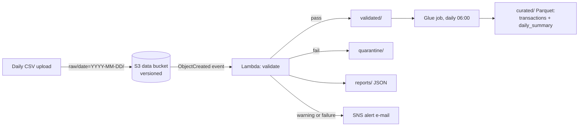
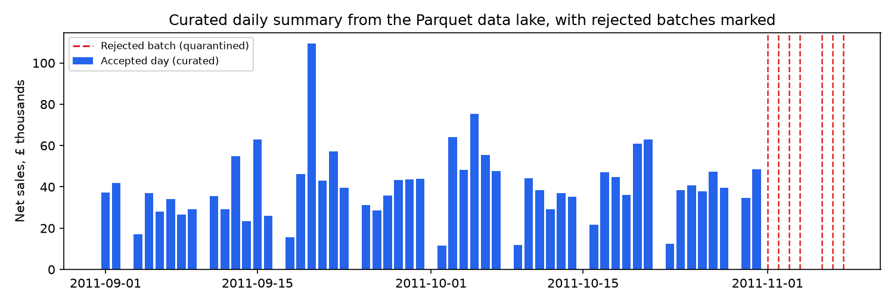

# AWS Serverless Data Pipeline for Daily Transaction Files

[](https://github.com/shubham-italiya/aws-serverless-data-pipeline/actions/workflows/ci.yml)


Daily transaction CSV files land in **S3**. A **Lambda** checks each file's data quality: good batches go on,
bad batches are **quarantined** and an **SNS alert** is sent. A scheduled **Glue** job turns the accepted
batches into a **Parquet data lake** partitioned by date. All infrastructure is one **AWS SAM / CloudFormation**
template.



## Demo: real files plus deliberately broken ones

52 real trading days (September-October 2011, Online Retail II) and 7 copies of real November days, each damaged
in one way, were uploaded to `raw/` in a fake AWS account ([moto](https://github.com/getmoto/moto)) and processed
by the real Lambda handler and Glue job code. Full output: [`reports/demo.md`](reports/demo.md).

| Input | Result |
|---|---|
| 52 real days | **all accepted**; 3 flagged with a warning for genuinely unusual volume (e.g. 20 Sep: sales z = +9.1) |
| Schema drift (`Price` renamed `UnitPrice`) | rejected: schema |
| 5% of quantities empty | rejected: null rates |
| 3 negative prices | rejected: business rules |
| Partial upload (5% of a usual day's rows) | rejected: completeness |
| File sent twice (51% duplicate rows) | rejected: duplicates |
| Previous day's rows mixed in | rejected: wrong dates |
| Unreadable binary file | rejected: cannot read CSV |

All 7 broken files were caught, no real day was rejected, and 10 alerts were sent. The curated data lake:



## Data-quality checks

| Check | Rule | On failure |
|---|---|---|
| Schema | exactly the expected 8 columns | reject |
| Not empty | at least one row | reject |
| Null rates | key fields never empty; description <= 6%; customer ID <= 70% (guest orders) | reject |
| Types | every quantity, price and timestamp parses | reject |
| Business rules | no negative prices, no zero quantities, every row dated on the batch day | reject |
| Completeness | at least 20% of a usual day's rows (median of the last 28 accepted days) | reject |
| Duplicates | warn above 3.5%, reject above 20% (file loaded twice) | warn / reject |
| Volume | rows and sales within ±4 robust z-scores (median/MAD) of the last 28 days | warn |

**How the limits were set:** from 518 days of history (December 2009 - August 2011), *before* the demo period:
errors at about the 99th percentile of normal days, warnings at about the 95th. For example, on a median day 19%
of order lines have no customer ID (guest orders), but on the 99th-percentile day it is 67%, so a strict limit
would reject good data. My first guesses (45% and 2%) would have rejected three real days; calibrating on older data fixed
that without looking at the demo days.

## Design decisions

- **One bucket, one prefix per stage.** The S3 trigger only fires for `raw/*.csv`; the Lambda writes to other
  prefixes, so it can never trigger itself in a loop.
- **Quarantine, never delete.** Rejected files are kept for 90 days (lifecycle rule) with a JSON report next to them.
- **Versioned, encrypted, private bucket.** Every overwrite is recoverable; public access is blocked.
- **History for volume checks** is a small JSON profile of the last 60 accepted days, updated by the Lambda.
- **Idempotent Glue job:** days already in the data lake are skipped, so the job can run on a schedule or be re-run.
- **Least-privilege IAM:** the Lambda can read/write only its bucket and publish only to its topic.

## Run it locally (no AWS account needed)

```bash
pip install -e ".[dev]"
make samples   # downloads Online Retail II (~45 MB) and writes sample_data/
make demo      # runs all files through the pipeline on moto; writes reports/demo.md and demo.png (~3 s)
make test      # 17 tests: every check, the Lambda (S3 moves, quarantine, SNS alerts) and the Glue job
make lint      # ruff + cfn-lint on the CloudFormation template
```

## Deploy to AWS

> This repository is not deployed. The template passes `cfn-lint`; deploying needs your own AWS account.

```bash
make glue-package                                          # dist/txpipe-1.0.0-py3-none-any.whl
aws s3 cp glue/run_curate.py s3://<artifact-bucket>/glue/
aws s3 cp dist/txpipe-1.0.0-py3-none-any.whl s3://<artifact-bucket>/glue/
sam build -t infra/template.yaml
sam deploy --guided --parameter-overrides AlertEmail=<you@example.com> ArtifactBucket=<artifact-bucket>
aws s3 cp sample_data/good/date=2011-09-01/transactions.csv s3://<DataBucketName>/raw/date=2011-09-01/
```

## Project structure

```
src/txpipe/checks.py            the data-quality checks and the report
src/txpipe/validate_handler.py  Lambda: read, check, move to validated/ or quarantine/, alert
src/txpipe/curate_job.py        Glue Python shell job: validated CSV -> Parquet data lake
src/txpipe/layout.py            bucket prefixes and keys
infra/template.yaml             SAM: bucket, SNS topic, Lambda + S3 trigger, Glue job + daily trigger, IAM
scripts/make_batches.py         sample daily files from real data, plus broken copies
scripts/demo.py                 end-to-end run on a fake AWS account
tests/                          pytest + moto (runs in CI on every push)
```

## Limitations and next steps

- pandas in Lambda suits files up to a few hundred MB; bigger files would need a Glue Spark job or chunked reading.
- Register the Parquet tables in the Glue Data Catalog and query them with Athena.
- Add a dead-letter queue for Lambda failures and a Step Functions workflow for re-processing quarantined files.

## Data

Chen, D. (2019). *Online Retail II* [Dataset]. UCI Machine Learning Repository. https://doi.org/10.24432/C5CG6D,
licensed [CC BY 4.0](https://creativecommons.org/licenses/by/4.0/). Downloaded by `make samples`; not stored here.
The broken files in the demo are real days damaged on purpose by `scripts/make_batches.py`.

## Background

This is a 2026 rebuild of a personal project from 2025. The original code was lost, so I rebuilt it with a public
dataset and tested it end to end on a mocked AWS account. All results on this page come from this rebuild.
